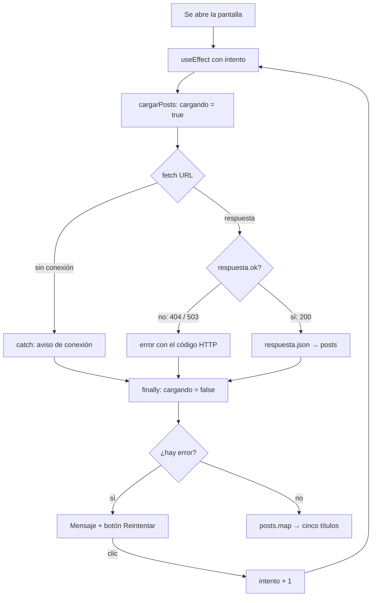

# Taller · Consulta a una API de terceros

**Práctica 3.3 · Grupo 03 · 7 minutos por equipo**

Cada equipo integra una pantalla Expo que consulta cinco publicaciones de [JSONPlaceholder](https://jsonplaceholder.typicode.com/posts?_limit=5), muestra un estado de carga y, si se pierde la conexión, deja reintentar la consulta.

| Archivo | Para qué sirve |
|---|---|
| `ConsultaExterna_taller.jsx` | La pantalla completa en un solo archivo. No depende de nada de Inventrex: se copia a un proyecto Expo vacío. |
| `README.md` | Estas instrucciones. |

Por equipo: una persona maneja el editor y otra verifica el resultado y toma las capturas.

---

## Antes de clase

- Node.js LTS y Google Chrome instalados.
- Crear el proyecto de práctica con anticipación (paso 1). La instalación descarga paquetes y no debe hacerse en los 7 minutos del taller.

## Paso 1 · Crear el proyecto de práctica

```bash
npx create-expo-app@latest taller-api --template blank
cd taller-api
npx expo install react-dom react-native-web
```

La plantilla `blank` no trae los paquetes para la web; la tercera línea los agrega.

## Paso 2 · Copiar el archivo y conectar `App.js`

1. Copien `ConsultaExterna_taller.jsx` en la carpeta `taller-api`, junto a `App.js`.
2. Reemplacen **todo** el contenido de `App.js` por esta línea:

```js
export { default } from './ConsultaExterna_taller';
```

Con esa línea, la pantalla del taller pasa a ser la aplicación completa.

## Paso 3 · Arrancar

```bash
npx expo start --web
```

Se abre Chrome en `http://localhost:8081`. Deben ver **Cargando publicaciones…** y después **cinco títulos**.

## Paso 4 · Leer el código

Localicen estas líneas en `ConsultaExterna_taller.jsx`. Una persona del equipo explica qué hace cada una.

| Línea | Qué hace |
|---|---|
| `const URL = '…/posts?_limit=5'` | Dirección del servicio: recurso `posts`, cinco registros. |
| `useEffect(() => { … }, [intento])` | Ejecuta la consulta al abrir la pantalla y cada vez que cambia `intento`. |
| `await fetch(URL)` | Hace la petición GET. |
| `if (!respuesta.ok)` | `fetch` no falla con 404 o 503; aquí revisamos el código y lo mostramos. |
| `await respuesta.json()` | Convierte la respuesta en datos que guardamos en `posts`. |
| `catch` | Sin conexión no llega respuesta HTTP: mostramos el aviso de conexión. |
| `finally { setCargando(false) }` | Termina la carga, haya salido bien o mal. |
| `posts.map((post) => …)` | Dibuja una tarjeta por publicación: muestra `title` y usa `id` como `key`. |
| `reintentar()` | Limpia el error, vuelve a cargar y suma 1 a `intento`, lo que dispara otra consulta. |

### Cómo fluye la lógica



## Paso 5 · Provocar el fallo

1. En Chrome abran DevTools (`F12`) → pestaña **Network** y recarguen la página.
2. Busquen la solicitud `posts?_limit=5`, hagan clic derecho → **Block request URL**.
3. Recarguen la página: debe aparecer *No se pudo consultar el servicio…* y el botón **Reintentar**.
4. Tomen la captura del error controlado.

> Alternativa: en **Network** cambien *No throttling* por **Offline**. Funciona igual; recuerden volver a *No throttling* al terminar.

Guía oficial: [bloquear peticiones en Chrome DevTools](https://developer.chrome.com/docs/devtools/request-conditions).

## Paso 6 · Recuperar la consulta

1. Abran **Request conditions** (o el panel de bloqueo) y desactiven el bloqueo.
2. Pulsen **Reintentar** en la pantalla, **sin recargar**.
3. Deben volver los cinco títulos. Tomen la captura.

## Evidencias para Moodle

- Captura con los cinco títulos.
- Captura del error controlado con el botón Reintentar.
- Una explicación breve de lo que cambiaron y los nombres reales del equipo.

Usen solo datos de demostración en las capturas.

## Si algo falla

| Síntoma | Revisen |
|---|---|
| Pantalla en blanco o error de importación | El archivo se llama exactamente `ConsultaExterna_taller.jsx` y está junto a `App.js`. |
| `expo start --web` pide instalar paquetes | Falta `npx expo install react-dom react-native-web` (paso 1). |
| Siempre aparece el error | El bloqueo sigue activo o dejaron **Offline** en Network. |
| Error con HTTP 404 | La `URL` está mal escrita. Debe ser `https://jsonplaceholder.typicode.com/posts?_limit=5`. |
| La carga es tan rápida que no se ve | En Network elijan **Slow 4G** un momento. |

## Relación con Inventrex

En Inventrex la misma pantalla vive en `src/screens/ConsultaExterna.jsx` y se abre desde **Inicio → Consulta externa** (`App.js`, pantalla `consultaExterna`). El archivo del taller es una versión reducida para practicar:

| | Inventrex | Taller |
|---|---|---|
| Dirección | constante `endpoint` | constante `URL` (misma dirección) |
| Cómo se abre | botón en Inicio, con login y menú | es la app completa |
| Estado | un objeto `{ cargando, error, posts }` | tres estados separados |
| Extras | límite de 10 s y validación de `id`/`title` | ninguno |
| Estilos | componente `Titulo` y tema glassmorphism | estilos en el mismo archivo |

Para verlo en Inventrex: `npm install`, después `npm run web`, iniciar sesión con la cuenta de demostración de `docs/README.md` y pulsar **Consulta externa**.
